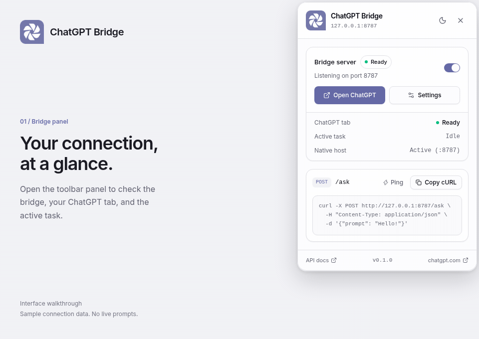

<p align="center">
  
</p>

<h1 align="center">ChatGPT Bridge</h1>

<p align="center">Your ChatGPT browser session, available to local apps.</p>

<p align="center">
  <a href="#quick-start">Quick start</a> ·
  <a href="#rest-api">REST API</a> ·
  <a href="#typescript-sdk">TypeScript SDK</a> ·
  <a href="#troubleshooting">Troubleshooting</a>
</p>

ChatGPT Bridge connects local scripts and apps to a signed-in ChatGPT tab. Send prompts, stream replies, attach files through the SDK, and collect the response as Markdown. It uses browser automation and your existing session, so ChatGPT account limits and website changes still apply.

<p align="center">
  
</p>

<p align="center"><sub>Interface walkthrough with sample connection data. No live ChatGPT prompts are sent in this recording.</sub></p>

## What you can do

- **Call ChatGPT over HTTP.** A simple `/ask` endpoint returns JSON or streams server-sent events.
- **Use familiar chat-completion clients.** `/v1/chat/completions` provides a limited OpenAI-compatible response format.
- **Build with TypeScript.** The bundled SDK supports streamed text, file attachments, task events, and cancellation.
- **Start the local server with Chrome.** Native Messaging launches the host after registration.
- **Manage the bridge in your browser.** A rounded page panel shows connection status and quick actions; settings include light, dark, and system themes.
- **Inspect broken automation.** Run diagnostics to see which ChatGPT page selectors still match.

## Quick start

### 1. Install and build

You need **Node.js 22.12 or newer**, npm, Chrome or Chromium, and a ChatGPT account you can sign in to.

The included native-host installer currently targets **Linux with Chrome or Chromium**. Native-host installation for other operating systems and Firefox is not included.

From this project directory:

```bash
npm install
npm run build
```

`npm install` prepares WXT, builds the local SDK, and registers the native host with the extension ID currently in the registration script. You will match that ID to your own installation below.

### 2. Load the extension

1. Open `chrome://extensions` and enable **Developer mode**.
2. Choose **Load unpacked** and select this project's `.output/chrome-mv3` directory.
3. Copy the extension's **ID** from its card.
4. Pin ChatGPT Bridge to the toolbar for easy access.

### 3. Authorize your extension ID

In [`scripts/register-native-host.ts`](./scripts/register-native-host.ts), replace the existing entry in `ALLOWED_ORIGINS` with your ID. Keep the trailing slash:

```ts
const ALLOWED_ORIGINS = [
  'chrome-extension://YOUR_EXTENSION_ID/',
];
```

Register again, then reload the extension from `chrome://extensions`:

```bash
npm run register:host
```

The installer writes `com.chatgpt.bridge.server.json` into the Chrome/Chromium `NativeMessagingHosts` directories and points it to this checkout's `scripts/native-host.sh`. Re-register if you move the project folder.

### 4. Connect your ChatGPT tab

Open [ChatGPT](https://chatgpt.com) in the same browser profile and sign in. Click the extension icon and leave **Bridge server** enabled. The default server address is `ws://127.0.0.1:8787`.

On normal webpages, the icon opens a rounded panel inside the page. Close it with **Escape**, the close button, an outside click, or another click on the toolbar icon. Restricted pages use the standard toolbar popup instead.

Check that the host is running and the extension is connected:

```bash
curl http://127.0.0.1:8787/health
```

Look for `"extensionConnected": true`, then send your first prompt:

```bash
curl -X POST http://127.0.0.1:8787/ask \
  -H 'Content-Type: application/json' \
  -d '{"prompt":"Explain quantum computing in two sentences."}'
```

Interactive documentation is available at [localhost:8787/docs](http://127.0.0.1:8787/docs) while the host is running.

## REST API

The native host serves HTTP and the extension's WebSocket connection on `127.0.0.1:8787` by default.

### Stream an answer

```bash
curl -N http://127.0.0.1:8787/ask \
  -H 'Content-Type: application/json' \
  -d '{"prompt":"Write a short haiku about browser extensions.","stream":true,"newChat":true}'
```

Streamed events contain a `delta`. The final event includes `done`, the complete `text`, and `elapsedMs`.

### Chat-completion format

```bash
curl -N http://127.0.0.1:8787/v1/chat/completions \
  -H 'Content-Type: application/json' \
  -d '{"model":"chatgpt-web","messages":[{"role":"user","content":"Hello!"}],"stream":true}'
```

For compatible clients, set the base URL to `http://127.0.0.1:8787/v1`. A client that requires an API-key value can use a placeholder; the current HTTP server does not authenticate it.

**Compatibility scope:** the handler forwards the latest user message to the browser. It does not implement full message-history replay, system messages, tool calling, model selection, or real token accounting. The selected ChatGPT browser conversation provides the context.

### Endpoints

| Method | Endpoint | Purpose |
| --- | --- | --- |
| `GET` | `/health` | Host status and extension connection info |
| `GET` | `/docs` | Interactive API documentation |
| `POST` | `/ask` | Send `prompt` or `message`; supports `stream` and `newChat` |
| `POST` | `/v1/chat/completions` | Chat-completion response format, with optional streaming |
| `POST` | `/new-chat` | Start a fresh conversation |
| `POST` | `/cancel` | Cancel a task; accepts an optional `taskId` |
| `GET` | `/diagnostics` | Inspect ChatGPT page selectors |
| `GET` | `/last-response` | Read the latest assistant response as Markdown |
| `POST` | `/reload-tab` | Reload the managed ChatGPT tab |
| `POST` | `/reload-extension` | Reload the unpacked extension |

File attachments are supported through the TypeScript SDK. The simple REST handler currently forwards text prompts only.

## TypeScript SDK

The SDK is included in [`sdk/`](./sdk); this project installs it as a local dependency. To use it in another Node.js project, build it and install from your checkout:

```bash
npm --prefix /path/to/chatgpt-bridge/sdk run build
npm install /path/to/chatgpt-bridge/sdk
```

`ChatGPTBridge` starts its own WebSocket host. Use a separate port, such as **8790**, to avoid colliding with the native HTTP host on 8787. In **Settings → Connection**, set the extension's server URL to `ws://127.0.0.1:8790` and save before running the example. The extension connects to one host at a time.

```ts
import { ChatGPTBridge } from '@chatgpt-bridge/local-sdk';

const bridge = new ChatGPTBridge({ port: 8790 });
await bridge.start();

try {
  await bridge.waitForExtension();
  const answer = await bridge.ask('Write a haiku about browser extensions.', {
    newChat: true,
    onDelta: (delta) => process.stdout.write(delta),
  });
  console.log(`\nCompleted in ${answer.elapsedMs} ms`);
} finally {
  await bridge.stop();
}
```

To attach a local file to an existing bridge session:

```ts
import { fileFromPath } from '@chatgpt-bridge/local-sdk';

const answer = await bridge.ask('Summarize this document.', {
  files: [fileFromPath('./report.pdf')],
});
```

Other useful methods include `send()`, `cancel(taskId)`, `getStatus()`, `getSession()`, `newChat()`, `getLastResponse()`, and `diagnostics()`. Subscribe to `task.delta`, `task.completed`, `task.failed`, and `task.cancelled` with `bridge.on()`.

For an interactive terminal demo, keep the extension pointed at port 8790 and run:

```bash
npm run demo -- --port 8790
npm run demo -- --port 8790 --prompt "Summarize what a service worker does."
npm run demo -- --port 8790 --prompt "Summarize this file." --file ./report.pdf
```

The REPL supports `:new`, `:status`, and `:quit`. Switch the extension's server URL back to port 8787 when returning to the native REST host.

## Settings

| Setting | Default | Purpose |
| --- | --- | --- |
| WebSocket server URL | `ws://127.0.0.1:8787` | Host the extension connects to |
| Shared secret token | Empty | Match a token configured on a custom SDK host |
| Auto-reconnect | On | Retry a dropped WebSocket connection |
| Reconnect base delay | `2000 ms` | Initial delay for reconnect backoff |
| Auto-open ChatGPT | On | Ensure a ChatGPT tab exists at browser startup |
| Ask timeout | `300 s` | Overall answer wait |
| Generation cap | `600 s` | Maximum generation duration |
| Delta batch | `100 ms` | Batch streamed text updates |
| Theme | Light | Light, dark, or system appearance |

The REST API tab includes request examples. The Diagnostics tab inspects the managed ChatGPT page and reports which selectors match.

## Development

| Command | Purpose |
| --- | --- |
| `npm run dev` | Start WXT development mode for Chrome |
| `npm run dev:firefox` | Start the Firefox development target |
| `npm run build` | Build `.output/chrome-mv3` and `.output/chrome-mv3-dev` |
| `npm run zip` | Package the extension into `.output/` |
| `npm run typecheck` | Check TypeScript |
| `npm run sdk:build` | Build `sdk/dist` |
| `npm run register:host` | Register the Linux Chrome/Chromium native host |
| `npm run server` | Run the standalone HTTP host manually |
| `npm run demo` | Start the SDK demo agent; accepts `--port`, `--prompt`, and `--file` |
| `npm run mock` | Connect a mock extension to an SDK host |

For local browser launch options, copy [`web-ext.config.example.ts`](./web-ext.config.example.ts) to `web-ext.config.ts`. The local file is ignored by Git so your browser profile paths stay on your machine. Production and development builds can have different extension IDs; authorize the ID of the build you actually load.

To run a manual HTTP host on another port, use `PORT=8791 npm run server` and point the extension at `ws://127.0.0.1:8791`.

### Test without a ChatGPT session

Use two terminals. Both commands use port 8790, separate from the native host:

```bash
# Terminal 1: the mock retries until the test host starts.
MOCK_PORT=8790 npm run mock
```

```bash
# Terminal 2: checks file inputs, cancellation, status, session, and errors.
SELFTEST_PORT=8790 npx tsx examples/sdk-selftest.ts
```

The mock produces sample responses; it does not contact ChatGPT.

## Troubleshooting

| Symptom | What to check |
| --- | --- |
| Local host is offline | Match your extension ID in `ALLOWED_ORIGINS`, run `npm run register:host`, and reload the extension. Chrome also needs an executable native-host script and access to Node.js. |
| `/ask` returns `503` | Enable the bridge and check the server URL. The extension must be connected to the same host receiving the HTTP request. |
| `EADDRINUSE` | Another process owns the port. Use a separate port for a manual server or SDK host. |
| ChatGPT tab is not detected | Open ChatGPT in the same browser profile, sign in, and reload the tab after installing or updating the extension. |
| `TASK_BUSY` | Wait for the current generation to finish, or cancel it before sending another prompt. |
| Composer or send-button errors | Run **Settings → Diagnostics**. ChatGPT UI changes may require updates to [`entrypoints/content/dom.ts`](./entrypoints/content/dom.ts). |
| Panel appears below a browser banner | The rounded panel belongs to the webpage. Chrome's toolbar and warning bars sit above that area. |

## Local access and permissions

The host binds to **127.0.0.1** by default. Keep it on loopback: callers with access to the server can drive the connected ChatGPT session.

The current HTTP server has **no request authentication** and enables cross-origin requests. A token on a custom SDK host validates the extension's WebSocket handshake; it does **not** authenticate HTTP requests. See [`sdk/src/server.ts`](./sdk/src/server.ts) before exposing the server beyond your own machine.

| Permission | Why it is used |
| --- | --- |
| `storage` | Save settings and mirror connection status |
| `tabs` | Locate and activate the ChatGPT tab |
| `alarms` | Keep the bridge connection alive |
| `nativeMessaging` | Start and communicate with the local host |
| `activeTab`, `scripting` | Open the page panel after a toolbar click |
| ChatGPT host access | Run automation on `chatgpt.com` and `chat.openai.com` |

## Project map

```text
entrypoints/background.ts   Connection lifecycle, toolbar action, and routing
entrypoints/content/        ChatGPT DOM automation and Markdown extraction
entrypoints/popup/          Shared panel and toolbar fallback interface
entrypoints/options/        Connection, API, automation, and diagnostics settings
components/ui/              shadcn/ui components
lib/                        Protocol, settings, page panel, and bridge helpers
sdk/                        Local TypeScript host and HTTP server
scripts/                    Native-host launcher and registration
examples/                   Demo agent, mock extension, and SDK self-test
docs/                       Protocol reference and README media
```

For message envelopes, RPC methods, and task events, read the [protocol reference](./docs/protocol.md).

Built with [WXT](https://wxt.dev), [React](https://react.dev), [shadcn/ui](https://ui.shadcn.com), [Tailwind CSS](https://tailwindcss.com), [Radix UI](https://www.radix-ui.com), and [Lucide](https://lucide.dev).
